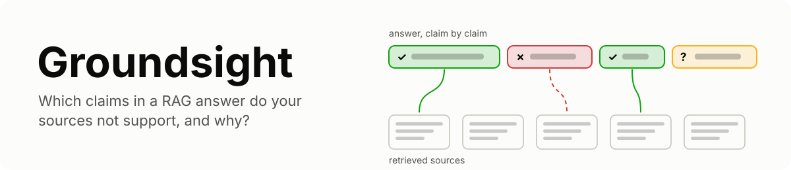
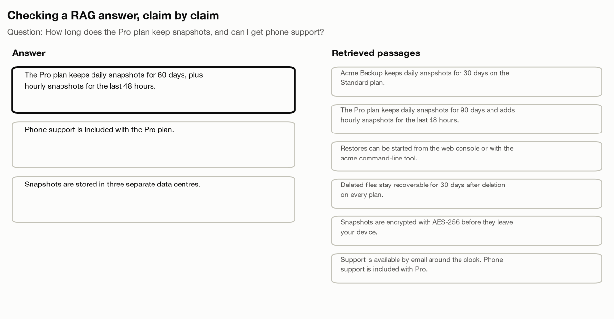
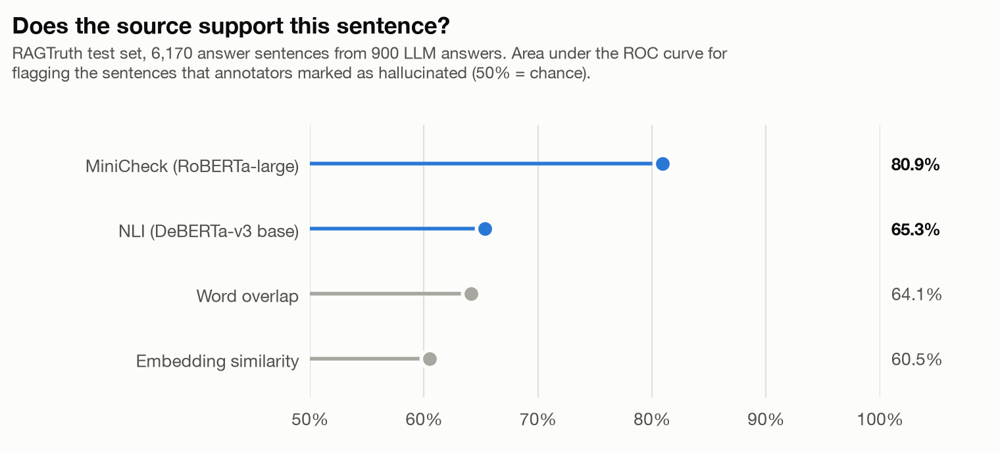
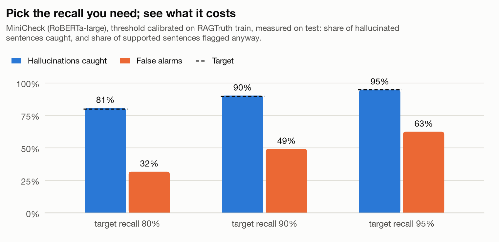

<picture>
  <source media="(prefers-color-scheme: dark)" srcset="docs/assets/banner-dark.svg">
  
</picture>

**Groundsight checks a RAG answer claim by claim against the passages it was given,
names why each bad claim went wrong, and confirms the cause by replaying the answer with
the fix.**

Most RAG tooling scores "groundedness" with embedding similarity. Similarity measures
whether two sentences are about the same thing, not whether one supports the other:

| Claim, against "The Eiffel Tower is 330 metres tall and was completed in 1889." | Embedding similarity | Groundsight |
|---|---|---|
| "The Eiffel Tower was completed in 1889." | 0.88 | supported (0.98) |
| "The Eiffel Tower is 500 metres tall." | 0.86 | contradicted (1.00) |

Groundsight checks each claim with fact-checking models: MiniCheck for support and an
NLI model for contradiction. It then points each claim at the exact sentence it rests on
and labels it supported, contradicted or unsupported. For every claim that fails, it says
which part of the pipeline to fix.

<picture>
  <source media="(prefers-color-scheme: dark)" srcset="docs/assets/audit-dark.gif">
  
</picture>

## What you get

1. **Claim-level verdicts with evidence.** Each sentence of the answer is checked
   against every passage, in windows for long ones. The verdict points at the sentence
   of the passage that supports or contradicts it.
2. **Thresholds you can trust.** They are calibrated on RAGTruth's human labels. Ask for
   a recall target, for example "catch at least 90% of unsupported claims", and get a
   threshold with a conformal guarantee plus the false-alarm rate it costs.
3. **Root-cause triage.** Every flagged claim gets one of six causes, each with the
   passages involved and where to fix it:
   1. retrieval miss;
   2. misleading source;
   3. conflicting sources;
   4. misread context;
   5. unsupported addition;
   6. evidence buried mid-context.
4. **Verification by replay.** Regenerate the answer with the fix the cause implies, for
   example dropping the misleading passage or moving the evidence to the top. Compare
   the result with plain resampling. A cause is confirmed only when the fix beats the
   noise.
5. **Attribution that reads the answer.** Find which passage made the model say each
   claim by scoring the claim's own tokens with and without each passage. A small local
   model can act as a proxy for a hosted one.
6. **Local by default.** Checking, triage and attribution run on open models on your
   machine. Only verification calls your LLM, and only when you ask.
7. **Fits your workflow.** You get:
   1. a single-file HTML report and a live local viewer;
   2. `assert_grounded` and a pytest fixture for RAG regression tests;
   3. a CLI;
   4. OpenTelemetry export with one `gen_ai.evaluation.result` event per claim.

## Quickstart

```bash
uv add "groundsight[models] @ git+https://github.com/Sanika0212/Groundsight"
uv run groundsight demo            # audits a built-in answer and writes a report
```

```python
import groundsight as gs

chunks = [
    "The Pro plan keeps daily snapshots for 90 days and adds hourly snapshots for the "
    "last 48 hours.",
    "Support is available by email around the clock. Phone support is included with Pro.",
]
answer = (
    "The Pro plan keeps daily snapshots for 60 days. Phone support is included with the "
    "Pro plan. Snapshots are stored in three separate data centres."
)

result = gs.audit(answer, chunks, question="How long are snapshots kept on Pro?")
for claim in result.claims:
    print(claim.verdict.value, "|", claim.text)
    if claim.diagnosis:
        print("   cause:", claim.diagnosis.cause.value, "-", claim.diagnosis.reason)
gs.write_report(result, "report.html")
```

```text
contradicted | The Pro plan keeps daily snapshots for 60 days.
   cause: misread_context - c0 (passage 1 of 2) contradicts the claim.
supported | Phone support is included with the Pro plan.
unsupported | Snapshots are stored in three separate data centres.
   cause: retrieval_miss - No passage covers this claim; the context is about something else.
```

The first run downloads the checker models (about 2 GB) from Hugging Face. After that,
everything runs offline.

## Capturing your pipeline

Mark the retrieval and generation steps, or let Groundsight record chat calls made
through `httpx`, the transport the official OpenAI and Anthropic SDKs use:

```python
import groundsight as gs

@gs.retriever
def search(query):           # strings, dicts or LangChain-style documents
    return vector_store.similarity_search(query, k=5)

@gs.generator
def respond(query, docs):
    return llm(query, docs)

with gs.trace("What is our refund window?") as t:
    respond(t.question, search(t.question))

print(f"{t.audit.groundedness:.0%} supported")   # also saved to .groundsight/audits.jsonl
```

Run `groundsight serve` to watch audits arrive in a local browser view. It binds to
localhost only.

## Confirming a cause

A diagnosis is a hypothesis until a replay confirms it. Give Groundsight a way to
answer again, either your own pipeline or a model with the default RAG prompt:

```python
checks = gs.verify(result, gs.PipelineResponder(my_answer_fn), samples=5)
for check in checks:
    best = check.best
    print(check.cause.value, "confirmed" if check.confirmed else "not confirmed",
          f"{best.intervention.label}: {best.successes}/{best.samples} fixed",
          f"vs {check.baseline.successes}/{check.baseline.samples} by resampling")
```

`gs.estimate(result, samples=5)` returns the number of calls a run will make. On the
command line, `groundsight verify AUDIT --model openai:gpt-4.1-mini` prints that number
and asks before calling a paid API.

## Testing RAG answers in CI

```python
def test_refund_answer(grounded):          # fixture from Groundsight's pytest plugin
    answer, docs = my_rag("What is the refund window?")
    grounded(answer, docs, max_unsupported=0)
```

Outside pytest fixtures, `groundsight.testing.assert_grounded` does the same. A failing
check lists every flagged claim with its cause and the contradicting evidence.
`pytest --groundsight-reports reports/` writes an HTML report for each failure.
`GROUNDSIGHT_CHECKER=lexical` gives a fast, model-free check for smoke tests.

## Command line

| Command | What it does |
|---|---|
| `groundsight audit FILE` | Audit answers from JSON or JSON Lines (`--html`, `--target-recall`, `--fail-on-flags`) |
| `groundsight report AUDIT` | Write the HTML report of a stored audit |
| `groundsight serve` | Live local view of stored audits |
| `groundsight verify AUDIT --model ...` | Confirm causes by replaying with fixes |
| `groundsight calibrate FILE` | Fit a calibration profile on your own labelled claims |
| `groundsight bench detect` / `bench faults` | Run the benchmarks |
| `groundsight export AUDIT` | OTLP JSON, or post to a collector |

## How it works

[docs/how-it-works.md](docs/how-it-works.md) covers claims, checkers, calibration and
the recall guarantee, the triage rules, verification and attribution.
[docs/benchmarks.md](docs/benchmarks.md) describes both benchmarks and how to reproduce
them.

## Results

Every number comes from [docs/benchmarks.md](docs/benchmarks.md), with the commands to
reproduce it.

### Does the source support this sentence?

[RAGTruth](https://huggingface.co/datasets/wandb/RAGTruth-processed) has answers from six
LLMs to question answering, summarisation and data-to-text tasks, with human annotations
of every hallucinated span. Thresholds were fitted on 900 training answers; everything
below is measured on 900 test answers (6,170 sentences).

<picture>
  <source media="(prefers-color-scheme: dark)" srcset="docs/assets/detection-dark.png">
  
</picture>

| Checker | AUROC | Balanced accuracy | QA | Summary | Data to text |
|---|---|---|---|---|---|
| **MiniCheck (Groundsight default for support)** | **0.809** | **0.744** | 0.839 | 0.816 | 0.761 |
| NLI (DeBERTa-v3) | 0.653 | 0.613 | 0.793 | 0.610 | 0.592 |
| Word overlap | 0.641 | 0.600 | 0.693 | 0.600 | 0.577 |
| Embedding similarity (common in RAG tooling) | 0.605 | 0.595 | 0.605 | 0.506 | 0.546 |

Embedding similarity, the usual "groundedness" score, is barely better than chance on
summaries (0.506): a sentence can be about the source without being supported by it.

**Pick the recall you need.** Ask for a recall target and Groundsight sets the threshold
with a conformal guarantee on held-out data; the false-alarm rate is the price.

<picture>
  <source media="(prefers-color-scheme: dark)" srcset="docs/assets/recall-dark.png">
  
</picture>

| Target recall | Achieved on test | Supported sentences flagged anyway |
|---|---|---|
| 80% | 80.8% | 31.8% |
| 90% | 90.3% | 49.3% |
| 95% | 94.9% | 62.5% |

### Why did it go wrong, and does the fix work?

<!-- fault results -->

## Limits

1. **Checkers are models and they make mistakes.** Treat every verdict as a lead to
   check, not a ruling. Reports show the evidence so you can.
2. **The recall guarantee assumes your claims resemble the calibration data.** Shipped
   profiles come from RAGTruth (English QA, summaries, data-to-text). Recalibrate with
   `groundsight calibrate` on labelled examples from your domain.
3. **Triage names one cause.** Real failures can mix causes. Verification tells you
   whether the named cause's fix works, not whether it is the only problem.
4. **Attribution needs likelihoods.** With a hosted model it uses a local proxy, which
   can disagree with the hosted model.

## Development

```bash
git clone https://github.com/Sanika0212/Groundsight.git && cd Groundsight
uv sync --extra models --extra bench --extra viz
uv run coverage run -m pytest && uv run coverage report      # no weights, no network
```

[CONTRIBUTING.md](CONTRIBUTING.md) lists the checks CI runs.

## References

1. Liyan Tang, Philippe Laban and Greg Durrett. MiniCheck: efficient fact-checking of
   LLMs on grounding documents. *EMNLP*, 2024.
2. Cheng Niu et al. RAGTruth: a hallucination corpus for developing trustworthy
   retrieval-augmented language models. *ACL*, 2024.
3. Benjamin Cohen-Wang, Harshay Shah, Kristian Georgiev and Aleksander Madry. ContextCite:
   attributing model generation to context. *NeurIPS*, 2024.
4. Fengyuan Liu, Nikhil Kandpal and Colin Raffel. AttriBoT: a bag of tricks for
   efficiently approximating leave-one-out context attribution. *ICLR*, 2025.
5. Christopher Mohri and Tatsunori Hashimoto. Language models with conformal factuality
   guarantees. *ICML*, 2024.
6. Nelson F. Liu et al. Lost in the middle: how language models use long contexts.
   *TACL*, 2024.
7. Zhilin Yang et al. HotpotQA: a dataset for diverse, explainable multi-hop question
   answering. *EMNLP*, 2018.
8. OpenTelemetry. Semantic conventions for generative AI systems.

## License

Apache License 2.0. Copyright 2026 Sanika Najan. See [LICENSE](LICENSE) and
[NOTICE](NOTICE).

Model weights and benchmark datasets are downloaded at run time and keep their own
licenses: MiniCheck is MIT-licensed; the NLI cross-encoders, HHEM, all-MiniLM-L6-v2
and the Qwen2.5 instruct models are Apache-2.0; HotpotQA is CC BY-SA 4.0.
